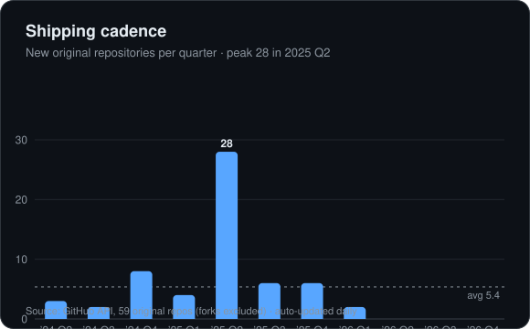
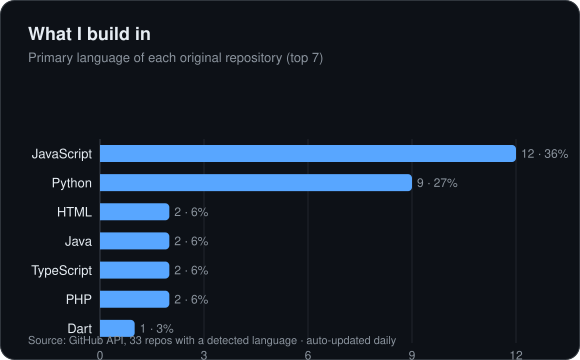
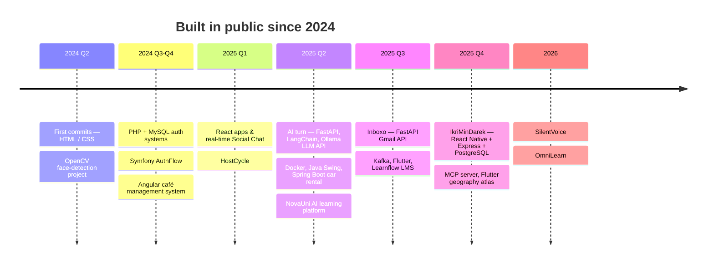
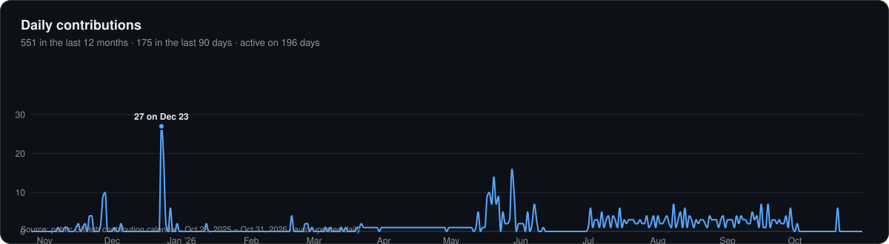

<a href="https://portfolio-teal-nine-41.vercel.app/">
  <picture>
    <source media="(prefers-color-scheme: dark)" srcset="assets/banner-dark.svg">
    <source media="(prefers-color-scheme: light)" srcset="assets/banner-light.svg">
    
  </picture>
</a>

 

<!-- 1 · WHO — neofetch card, portrait drawn with code; regenerated daily -->
<picture>
  <source media="(prefers-color-scheme: dark)" srcset="assets/neofetch-dark.svg">
  <source media="(prefers-color-scheme: light)" srcset="assets/neofetch-light.svg">
  
</picture>

  

---

## 🏗️ How I ship

How the pieces of my stack connect: clients call APIs over REST, APIs own their data and publish events, and the AI layer sits behind FastAPI.

<picture>
  <source media="(prefers-color-scheme: dark)" srcset="assets/architecture-dark.svg">
  <source media="(prefers-color-scheme: light)" srcset="assets/architecture-light.svg">
  
</picture>

## 📊 By the numbers

<table>
<tr>
<td width="50%">
<picture>
  <source media="(prefers-color-scheme: dark)" srcset="assets/chart-cadence-dark.svg">
  <source media="(prefers-color-scheme: light)" srcset="assets/chart-cadence-light.svg">
  
</picture>
</td>
<td width="50%">
<picture>
  <source media="(prefers-color-scheme: dark)" srcset="assets/chart-languages-dark.svg">
  <source media="(prefers-color-scheme: light)" srcset="assets/chart-languages-light.svg">
  
</picture>
</td>
</tr>
</table>

Charts are rendered with <b>Recharts</b> from live GitHub API data (<code>charts/build.mjs</code>) and refreshed daily.

## 🛣️ Journey

The story behind the cadence chart: each quarter, what I learned and shipped.

## 🚀 Featured builds

| Project | What it is | Stack (as in the diagram) |
|---|---|---|
| [**IkriMinDarek**](https://github.com/MaizaAymen/IkriMinDarek) | Property rental platform with real-time chat | React Native → Express → PostgreSQL |
| [**NovaUni**](https://github.com/MaizaAymen/NovaUni) | Learning platform with AI-generated content & quizzes | JavaScript · AI |
| [**Learnflow**](https://github.com/MaizaAymen/Learnflow) | Learning management system | JavaScript |
| [**Inboxo**](https://github.com/MaizaAymen/Inboxo) | REST API to send, read and manage Gmail | FastAPI |
| [**LLM API**](https://github.com/MaizaAymen/LLM_Acces_with_FastAPI_and_Ollama) | HTTP access to a local LLM, containerised | FastAPI → Ollama · Docker |
| [**OasisQuest**](https://github.com/MaizaAymen/OasisQuestPlate) | Marketplace for premium dates | Symfony → MySQL |

## 📈 Contributions

<picture>
  <source media="(prefers-color-scheme: dark)" srcset="assets/chart-activity-dark.svg">
  <source media="(prefers-color-scheme: light)" srcset="assets/chart-activity-light.svg">
  
</picture>

<table>
<tr>
<td width="50%" valign="top">

</td>
<td width="50%" valign="top">

### ⚡ Recent activity

<!--START_SECTION:activity-->
<!--END_SECTION:activity-->

</td>
</tr>
</table>

⏱ Card, charts and activity refresh automatically every day · <a href="https://portfolio-teal-nine-41.vercel.app/">portfolio</a>

